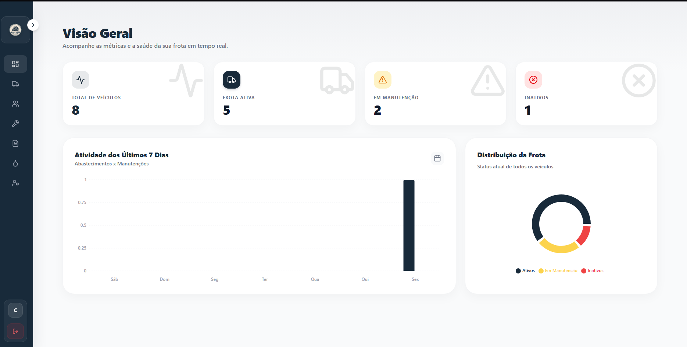
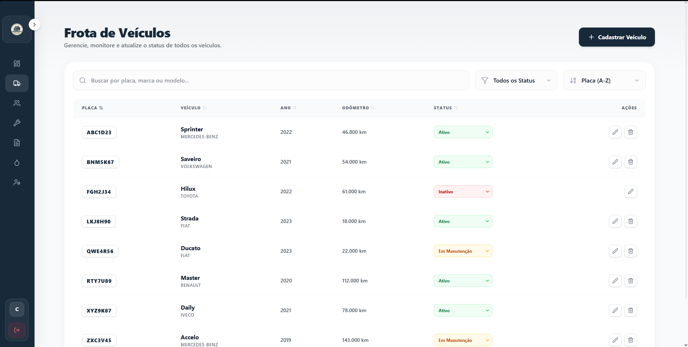
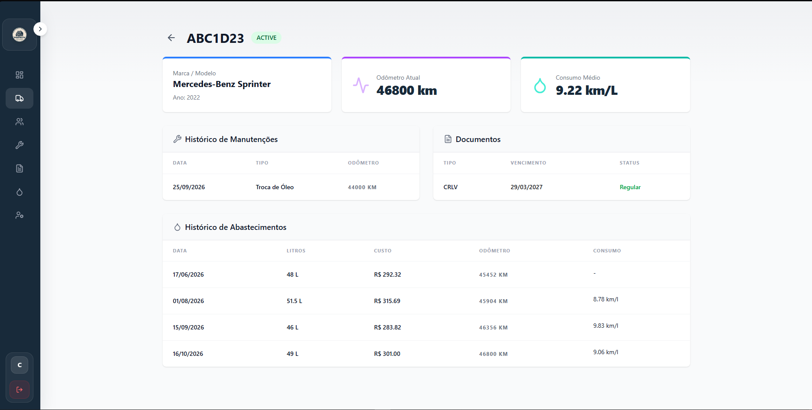
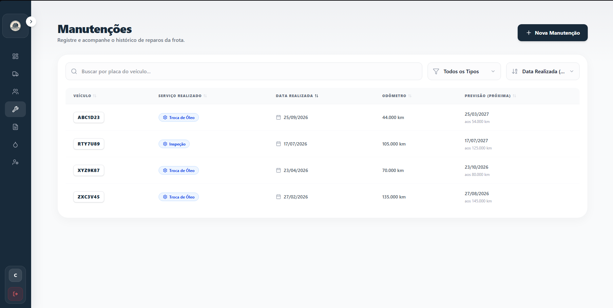
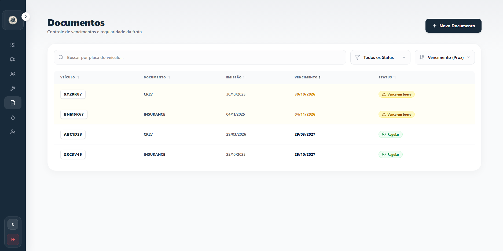
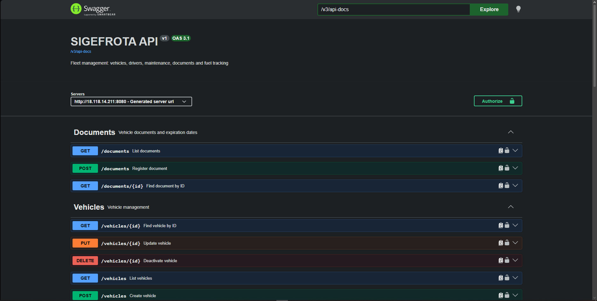
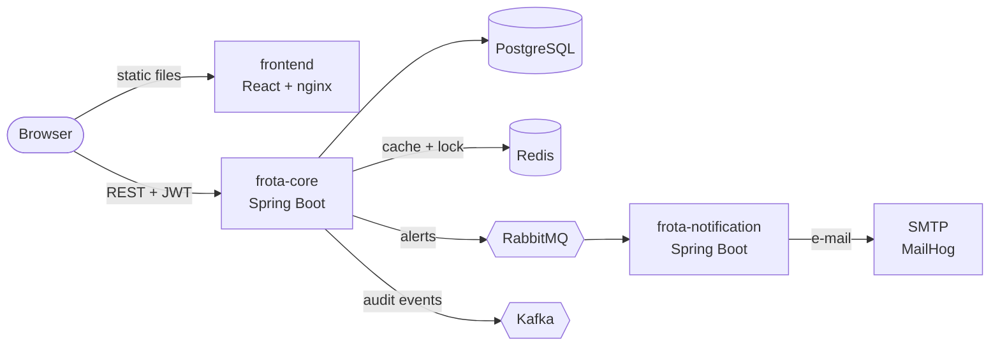

<div align="center">


# SIGEFROTA

**Integrated Fleet Management System**
*Sistema Integrado de Gestão de Frota*

Manage vehicles, drivers, maintenance, documents and fuel consumption, with automatic alerts and an audit trail.

<br>

[](http://18.118.14.211)
[](http://18.118.14.211:8080/swagger-ui/index.html)

<br>

[](https://github.com/carlosegzm/SIGEFROTA/actions/workflows/ci.yaml)


</div>

---

## Table of contents

- [About](#about)
- [Screenshots](#screenshots)
- [Features](#features)
- [Tech stack](#tech-stack)
- [Architecture](#architecture)
- [Roles and access](#roles-and-access)
- [Running locally](#running-locally)
- [Deployment](#deployment)
- [Known limitations](#known-limitations)
- [Roadmap](#roadmap)
- [Author](#author)

---

## About

SIGEFROTA is a full-stack project built end to end by a single developer, from the database schema to the cloud deployment. It covers the daily routine of a fleet: keeping vehicles and drivers organized, tracking maintenance and documents before they expire, and analysing fuel consumption to spot anomalies.

It is split into two Spring Boot services and a React frontend, communicating through REST and message brokers, and it is running live on AWS.

> [!NOTE]
> **Demo login (read-only):** `demo@sigefrota.com` / `Demo@2026`
>
> The demo runs on a single AWS EC2 instance under the AWS Free plan, so it may go offline when the free credits end. The screenshots below show the whole system.

---

## Screenshots

<table>
  <tr>
    <td align="center" width="50%">
      <br>
      <sub><b>Dashboard</b></sub>
    </td>
    <td align="center" width="50%">
      <br>
      <sub><b>Vehicles</b></sub>
    </td>
  </tr>
  <tr>
    <td align="center" width="50%">
      <br>
      <sub><b>Vehicle details:</b> average consumption and fuel history</sub>
    </td>
    <td align="center" width="50%">
      <br>
      <sub><b>Maintenance</b> with next-due predictions</sub>
    </td>
  </tr>
  <tr>
    <td align="center" width="50%">
      <br>
      <sub><b>Documents</b> with expiration alerts</sub>
    </td>
    <td align="center" width="50%">
      <br>
      <sub><b>Swagger / OpenAPI</b></sub>
    </td>
  </tr>
</table>

---

## Features

| Area | What it does |
|---|---|
| **Vehicles** | Full CRUD, status control (active, in maintenance, inactive) and automatic odometer update on every refuel |
| **Drivers** | Full CRUD with license category and expiration tracking |
| **Maintenance** | History per vehicle and next-due kilometer and date, calculated from the service type |
| **Documents** | CRLV, insurance and licensing with expiration dates and an "expires soon" status |
| **Fuel** | Consumption (km/L) calculated on every refuel, cached average of recent refuels, anomaly detection when a refuel deviates more than 20% from the average |
| **Alerts** | A daily job (08:00) finds maintenance and documents due within 30 days. Alerts are published to RabbitMQ and sent by e-mail by a separate notification service |
| **Audit trail** | Every create operation publishes an audit event to Kafka |
| **Security** | Stateless JWT authentication and role-based access |
| **Web interface** | React single-page app with role-aware UI and translated error messages |
| **Quality** | Unit and integration tests (including RabbitMQ and Kafka) running on GitHub Actions |

---

## Tech stack

| Layer | Technologies |
|---|---|
| **Backend** | Java 21, Spring Boot 4, Spring Security (JWT), Spring Data JPA, Flyway, springdoc-openapi |
| **Messaging** | RabbitMQ (alerts), Apache Kafka (audit events) |
| **Data** | PostgreSQL, Redis (cache), Redisson (distributed lock) |
| **Frontend** | React 19, Vite, TypeScript, Tailwind CSS, nginx |
| **Observability** | Spring Boot Actuator, Prometheus, Grafana |
| **Infra** | Docker, Docker Compose, AWS EC2, GitHub Actions |
| **Workflow** | Maven, Git with Conventional Commits, one branch per task, GitHub issues and pull requests |

---

## Architecture



| Service | Responsibility |
|---|---|
| **`frota-core`** | REST API, business rules, authentication, persistence, scheduled job and event publishing |
| **`frota-notification`** | Consumes alerts from RabbitMQ and sends e-mail notifications |
| **`frontend`** | React SPA served by nginx |

The full diagram, the main data flows and the reasoning behind each decision are in **[docs/ARCHITECTURE.md](docs/ARCHITECTURE.md)**.

---

## Roles and access

| Role | Access |
|---|---|
| `FLEET_MANAGER` | Read and write everything, manage user roles |
| `FINANCE` | Read-only |
| `DRIVER` | Read-only (default role for new accounts) |

---

## Running locally

**Requirements:** Docker and Docker Compose.

**1. Create the environment file**

```bash
cp .env.example .env
```

Edit `.env` and set the database and RabbitMQ credentials and a long random `JWT_SECRET`.

**2. Build and start everything**

```bash
docker compose up -d --build
```

**3. Open the services**

| Service | URL |
|---|---|
| Frontend | http://localhost:5173 |
| API | http://localhost:8080 |
| Swagger | http://localhost:8080/swagger-ui/index.html |
| MailHog (received e-mails) | http://localhost:8025 |
| RabbitMQ management | http://localhost:15672 |
| Prometheus | http://localhost:9090 |
| Grafana | http://localhost:3000 |

New accounts are created as `DRIVER`. To get write access, promote one user to `FLEET_MANAGER` directly in the database. After that, that user can change other users' roles from the **Users** page.

To run the tests of a service:

```bash
cd frota-core && ./mvnw test
```

---

## Deployment

The production setup runs on a single AWS EC2 instance (t3.small, 2 GiB RAM plus 2 GiB swap) using `docker-compose.prod.yml`:

```bash
docker compose -f docker-compose.prod.yml up -d --build
```

This file is a leaner version of the local stack: no Prometheus or Grafana, JVM heap limits for each service, and only the frontend (port 80) and the API (port 8080) exposed. Databases, brokers and the actuator port stay private. The production `.env` also needs `CORS_ALLOWED_ORIGINS` and `VITE_API_URL`.

More details in [docs/ARCHITECTURE.md](docs/ARCHITECTURE.md#deployment).

---

## Known limitations

- The demo runs over plain HTTP, with no domain or TLS certificate.
- The public IP is not fixed. Stopping the instance changes it and requires rebuilding the frontend (rebooting is safe).
- Role changes only take effect after the user logs in again, because the role is inside the JWT.
- The first `FLEET_MANAGER` is created manually in the database.
- The daily expiration job has no distributed lock, so running several instances of `frota-core` would send duplicate alerts.
- List filtering is done on the client side.
- Error translation in the frontend depends on the backend message text. A stable error `code` in the API response would be more robust.

---

## Roadmap

- [ ] Trip management (CRUD)
- [ ] Lock for the scheduled job (for example with ShedLock), to allow several instances
- [ ] Kafka consumer for the audit events
- [ ] HTTPS with a custom domain
- [ ] Kubernetes (Minikube) deployment phase
- [ ] Frontend code splitting

---

## Author

**Carlos Eduardo Garcez Mattos**
Computer Science student at IFSC, Lages, SC, Brazil.

[](https://www.linkedin.com/in/carlosegzm/)
[](https://github.com/carlosegzm)