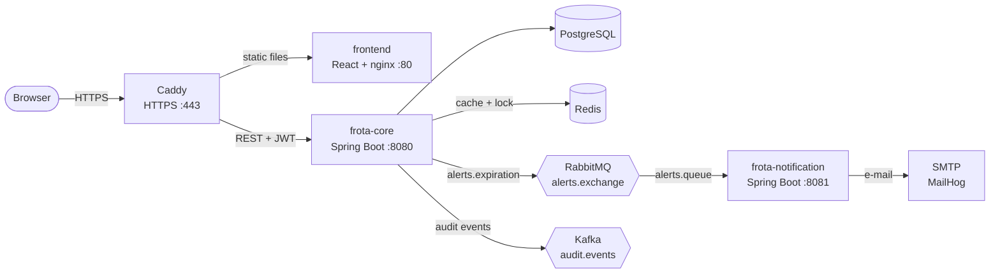
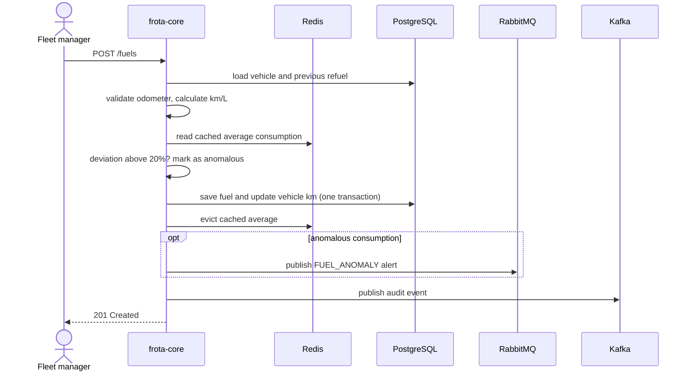

# SIGEFROTA: Architecture

This document explains how SIGEFROTA is organized, how data flows through it and why the main technical decisions were made.

**Contents**

- [Overview](#overview)
- [Services](#services)
- [Main flows](#main-flows)
- [Key decisions](#key-decisions)
- [Security](#security)
- [Observability](#observability)
- [Deployment](#deployment)
- [Lessons learned](#lessons-learned)

---

## Overview

> [!NOTE]
> In production, Caddy is the only public entry point. It serves the frontend on `sigefrota.duckdns.org` and the API on `api-sigefrota.duckdns.org`. The browser loads the static frontend and then calls the API directly. The API URL is defined at build time (`VITE_API_URL`).

---

## Services

| Service | Responsibility | Port |
|---|---|---|
| **`caddy`** | Reverse proxy with automatic HTTPS (production only) | 80, 443 |
| **`frontend`** | React SPA served by nginx with SPA fallback | 80 inside the network (5173 locally) |
| **`frota-core`** | REST API, business rules, authentication, persistence, scheduled job, event publishing | 8080 inside the network (actuator on 8082, not published) |
| **`frota-notification`** | Consumes alerts from RabbitMQ and sends them by e-mail | 8081 |

**Infrastructure:** PostgreSQL, Redis, RabbitMQ, Kafka (single node, KRaft mode) and MailHog. The local stack also runs Prometheus and Grafana.

---

## Main flows

### Registering a fuel record

1. The manager submits liters, cost, date and odometer.
2. `frota-core` validates that the odometer is greater than the previous reading and calculates consumption (km/L).
3. The consumption is compared with the cached average of recent refuels. A deviation above 20% marks the record as anomalous.
4. The record is saved and the vehicle `currentKm` is updated in the same transaction.
5. The cached average for that vehicle is evicted.
6. If the record is anomalous, an alert is published to RabbitMQ. An audit event is published to Kafka.

### Registering a maintenance

Each maintenance type defines a kilometer and a month interval. On creation, `frota-core` calculates the next due kilometer and date.

To avoid two simultaneous requests for the same vehicle being processed together, the operation takes a distributed lock in Redis through Redisson (one lock per vehicle, waiting up to 5 seconds and holding for up to 10). If the lock cannot be acquired, the API answers with a business-rule error asking the client to retry shortly.

### Expiration and anomaly alerts

A scheduled job in `frota-core` runs every day at 08:00. It looks for maintenances and documents that are due within the next 30 days and publishes one alert message for each to `alerts.exchange` with the routing key `alerts.expiration`. Fuel anomalies are published to the same exchange as soon as they are detected.

The message is routed to `alerts.queue`, where `frota-notification` consumes it and sends an e-mail to the fleet manager through SMTP. In the demo and in the local stack, MailHog captures these e-mails, so nothing is sent to real addresses.

Separating the services means a slow or failing notification never blocks the main API.

### Audit trail

The services for vehicles, drivers, documents, maintenances and fuel records publish events such as `FUEL / CREATED` to the Kafka topic `audit.events`, keeping an append-only record of what happened, decoupled from the request that caused it.

Today the system only produces these events. Consumers can be added later (for example, a service that stores them for reports) without changing `frota-core`.

---

## Key decisions

| Decision | Reason |
|---|---|
| **Two services instead of one** | Notifications are a different concern with a different failure profile. Keeping them separate shows asynchronous integration without splitting the domain too early. |
| **RabbitMQ for alerts** | Alerts are commands to be delivered once to a worker. A queue with routing fits better than a log. |
| **Kafka for audit events** | An append-only log suits an audit trail, and consumers can be added and replay it later. |
| **Redis cache for average consumption** | The average is read on every refuel and changes rarely. It is cached with a 10-minute TTL and evicted when a new refuel is created. |
| **Redisson lock per vehicle** | Serializes concurrent maintenance registrations for the same vehicle, and keeps working if the API runs on more than one instance. |
| **Stateless JWT** | No server-side session, so the API scales horizontally and the frontend only needs to send the token. |
| **Roles `FLEET_MANAGER`, `FINANCE`, `DRIVER`** | Writes are limited to managers. The other roles are read-only. |
| **Flyway with `ddl-auto: validate`** | The schema is versioned in migrations and Hibernate never changes it. |
| **Caddy as reverse proxy** | Obtains and renews Let's Encrypt certificates by itself, so the API and frontend are served over HTTPS with a small configuration file and no extra cost. |
| **Docker Compose for production** | The target is a single small instance. Compose keeps the deployment reproducible without the cost of an orchestrator. |

---

## Security

- HTTPS for the frontend and the API, with certificates issued and renewed automatically by Caddy.
- Stateless JWT authentication, secret provided by environment variable.
- Role-based authorization: write endpoints require `FLEET_MANAGER`, and user and role management too.
- Public endpoints are only login, registration and the API documentation.
- CORS restricted to the frontend origin.
- Secrets live in a `.env` file on the server and are never committed.
- In production, the database, Redis, brokers and the actuator port are not exposed to the internet.

---

## Observability

- Spring Boot Actuator runs on a separate management port (8082), which is not published in production.
- In the local stack, Prometheus scrapes `/actuator/prometheus` from `frota-core` every 15 seconds, and Grafana provides the `sigefrota-overview` dashboard.
- Prometheus and Grafana are left out of the production compose file to save memory on the small instance.

---

## Deployment

The system runs on one AWS EC2 instance (t3.small, 2 GiB RAM) using `docker-compose.prod.yml`.

| Topic | Setup |
|---|---|
| **Memory** | A 2 GiB swap file and JVM heap limits per service (`-Xmx320m` for `frota-core`, `-Xmx256m` for `frota-notification`) keep all containers running on 2 GiB |
| **Network** | The security group allows SSH only from the maintainer's IP, and HTTP (80) and HTTPS (443) for Caddy. The API and frontend ports are not published, so all traffic goes through the proxy |
| **Kafka** | Internal and controller listeners, with replication factors set to 1 for a single node |
| **Cost** | The project runs inside the AWS Free plan credits. The public IP is not an Elastic IP, to avoid extra charges. If the instance is stopped, the IP changes and the DuckDNS records must be updated |
| **CI** | GitHub Actions runs the tests of both services and the lint and build of the frontend on every pull request |

---

## Lessons learned

Problems found while putting the system into production, and how they were solved.

| Problem | Cause | Fix |
|---|---|---|
| `Cannot find cache named 'averageConsumption'` | Redisson brings a JCache provider, so Spring Boot chose the JCache manager (which does not create caches on demand) instead of the Redis one | Set `spring.cache.type: redis` explicitly |
| Kafka unreachable from containers | The broker advertised only `localhost:9092` | Separate internal and external listeners |
| Notification service in a crash loop | It started before anyone had declared `alerts.queue` | Declare the queue in the consumer as well |
| Build failing on JDK 23+ | Annotation processors on the classpath are no longer run by default, so Lombok stopped working | `annotationProcessorPaths` in the compiler plugin |
| 404 and 405 returned as 500 | A catch-all exception handler swallowed Spring's own errors | Explicit handlers declared before the catch-all |
| Stale vehicle odometer | Fuel records were saved but `Vehicle.currentKm` was never updated. Found in the live demo | Update it inside the same transaction |

---

## Known limitations and future work

See the [README](../README.md#known-limitations) for the current list of limitations and the roadmap.